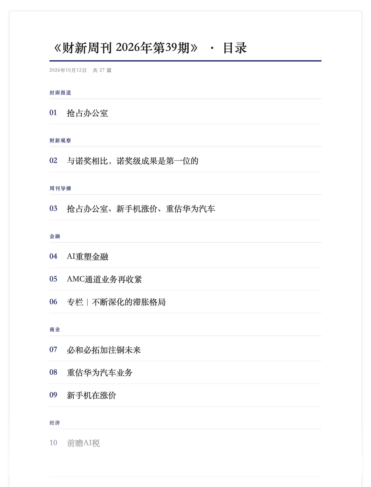
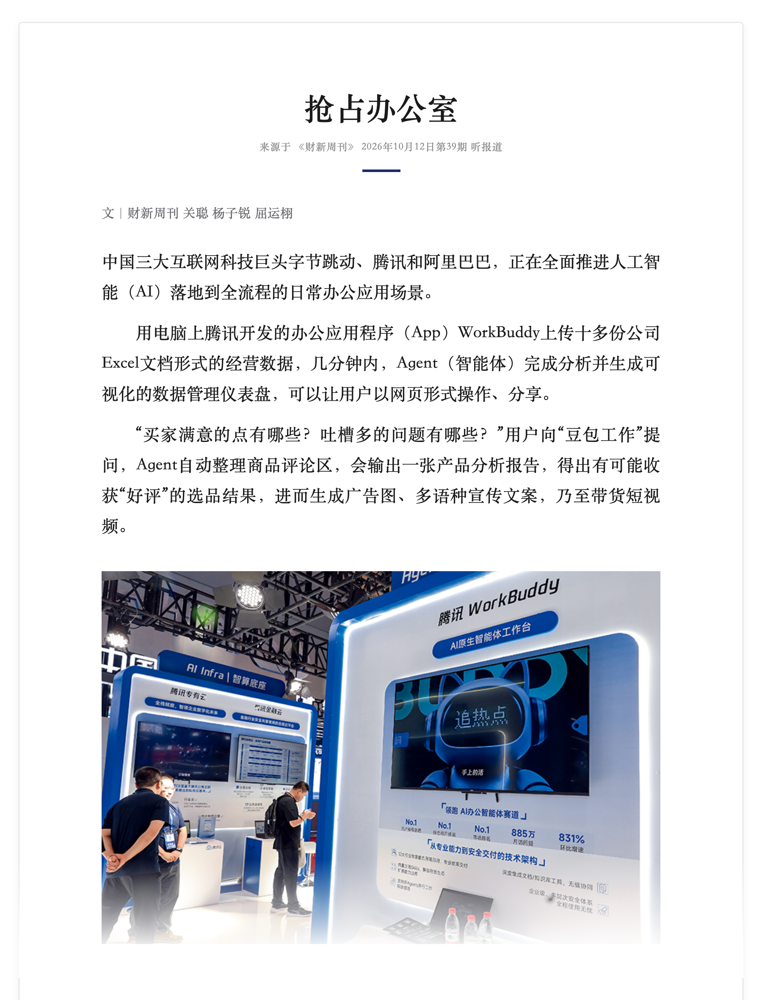

# Caixin Downloader

**把已订阅的《财新周刊》打包成排版精良的离线 EPUB。**

[](https://github.com/Golden0Voyager/caixin-downloader/actions/workflows/ci.yml)
[](LICENSE)
[](pyproject.toml)
[](#质量保障)

---

## 阅读效果

| 目录：按栏目分组 | 正文：图文混排 |
|:---:|:---:|
|  |  |

同一份 EPUB 在 Apple Books、Kindle、静读天下、Calibre 里都能正常显示：字号与间距全部用 `em`，跟随阅读器缩放；图片全部内嵌，断网可读。

## 特性

**抓取**

- 自动探测最新一期，历史期刊分页浏览，可一次勾选多期批量下载
- 正文双通道：拦截 `checkAuthByIdJsonp` 接口 + 解析 DOM，取更长的一份
- 「余下全文」静默失败会自动重试，避免只入库第一页
- 单篇失败不影响整期；空章（抓空的图集、休刊启事）自动剔除
- 并发 2 + 失败重试，单期 20~30 篇约 4 分钟

**排版**

- 20px 基准字号、1.8 行高、两端对齐、**每行上限 33 字**（宽屏不再拉成一条长线）
- 目录按栏目分组（封面报道 / 财新观察 / 金融 / 商业 …），与纸刊版面一致
- 章末「上一篇 · 目录 · 下一篇」，长篇连读不用回目录
- 图片带 `alt`，`nav` 带 `landmarks`，屏幕阅读器与「跳转到」菜单可用
- 自动剥离段首全角缩进、水印、文末「相关阅读」，缩进完全交给 CSS

## 快速开始

### 前置条件

- **财新付费会员** —— 本工具只辅助备份你已付费订阅的内容，不绕过付费墙
- Python 3.12+ 与 [uv](https://docs.astral.sh/uv/getting-started/installation/)

### 安装

```bash
git clone https://github.com/Golden0Voyager/caixin-downloader.git
cd caixin-downloader

uv sync                              # 安装依赖
uv run playwright install chromium   # 下载浏览器（只需一次）
```

### 准备 Cookie

1. 用付费账号登录 [weekly.caixin.com](https://weekly.caixin.com/)
2. 用 [EditThisCookie](https://chromewebstore.google.com/detail/editthiscookie/fngmhnnpilhplaeedifhccceomclgfbg)（Chrome）或 [Cookie-Editor](https://addons.mozilla.org/firefox/addon/cookie-editor/)（Firefox）导出 JSON
3. 保存为项目根目录的 `cookies.json`

```bash
uv run python test_caixin.py    # 验证 Cookie 是否有效
```

> Cookie 一般能撑数天到数周。失效的表现是：正文只剩开头一段，或整期大量空章。

### 运行

```bash
uv run python main.py
```

1. 同意免责声明
2. 在列表里用 `↑↓` 移动、`空格` 勾选、`回车` 开始下载（可直接勾多期）
3. 翻页：`下一页` / `上一页` / `加载更多` / `手动输入期号`（如 `cw1226`）
4. 确认清单后再回车，开始抓取

成品输出到 `download/`：

```
download/2026-10-12 (第39期) - 抢占办公室.epub
```

## 项目结构

```
main.py                 入口（30 行）
caixin/
  config.py             常量、终端输出对象
  text.py               纯文本后处理（标题、缩进、截断、日期）
  fetcher.py            页面抓取：目录解析、正文提取、资源拦截
  images.py             图片下载、缩放、分级、嵌入
  epub_builder.py       EPUB 组装（目录页、章节、导航、样式表）
  cookies.py            Cookie 加载
  cli.py                交互选期与流程编排
style/default.css       排版样式（em 尺度体系）
tests/                  244 个用例，含离线 Playwright 替身
```

## 质量保障

| 项 | 现状 |
|---|---|
| 单元测试 | 244 passed |
| 覆盖率 | **97.76%**（分支覆盖，仅统计产品代码） |
| CI 门禁 | ruff · mypy · bandit · pip-audit · pytest --cov（`fail_under=90`） |

抓取链路以前被认为「没法单测」，现在靠 `tests/fakes.py` 里的一套离线 Playwright 替身覆盖：`get_toc` 变成纯解析测试，`scrape_article` 能造出「API 比 DOM 长」「点余下全文失败」「图片 404」这些真实事故场景，`cli.main()` 的五条交互分支也能逐个走通。

## 常见问题

**正文只有开头一段 / 大量空章？**
Cookie 失效了。重新导出覆盖 `cookies.json`，再跑 `test_caixin.py` 确认。

**目录里的条目比纸刊少？**
少数短栏目（如《休刊启事》，35 字且无图）会按空章规则跳过，避免出现点进去只有标题的条目。

**终端里中文显示成方块？**
`export LANG=zh_CN.UTF-8` 后重跑。

**能下别的内容吗？**
不能。站点结构、栏目标记、正文容器都是按《财新周刊》写的。

## 免责声明

- 本工具仅供**个人学习、研究及备份已付费内容**使用，必须配合财新付费会员
- 下载内容的版权归 **财新传媒（Caixin Media）** 所有
- 严禁用于商业用途或公开传播；请在下载后 24 小时内删除
- 使用本工具产生的一切法律责任由使用者自行承担

## License

[MIT](LICENSE)
